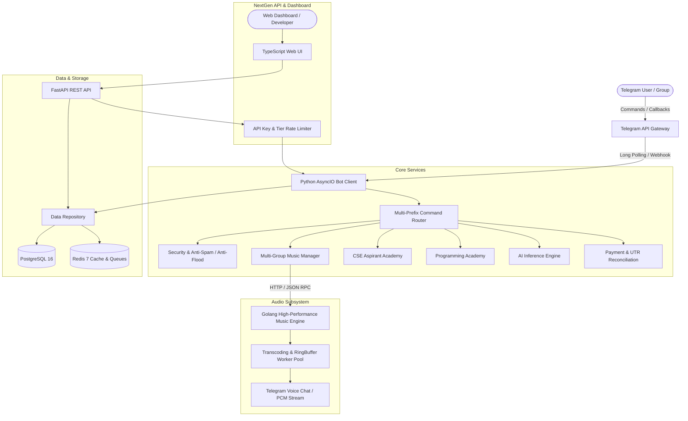

# CSE ASPIRANT – SYSTEM ARCHITECTURE

## 1. Overview

**CSE ASPIRANT** is a next-generation distributed Telegram bot and educational academy engineered for high concurrency, ultra-low-latency audio streaming, and bilingual learning (Hindi & English).

## 2. Component Breakdown

### 2.1 Python AsyncIO Core & Bot
- **Routing**: Multi-prefix parser supporting `/command`, `!command`, and `.command`.
- **Event Bus**: Asynchronous decoupling of chat events, state updates, and metrics collection.
- **Error Handling**: Custom exception hierarchy, exponential backoff retries, and circuit breakers.

### 2.2 Golang High-Performance Music Engine (`golang/`)
- **Worker Pool**: 8 parallel workers processing audio transcodes and ring buffer allocations.
- **Safe Recovery**: Panic-safe goroutines with automatic recovery middleware on HTTP handlers.
- **Ring Buffer**: Thread-safe in-memory audio chunk caching to withstand network packet jitter.

### 2.3 NextGen FastAPI Server (`api/`)
- **Authentication**: `X-API-Key` headers enforcing tier-based rate limits (FREE: 10/min, PREMIUM: 100/min, PRO: 1000/min). Master owner bypass for administrative control.
- **Telemetry**: Prometheus-compatible metric exposition at `/metrics` and system health at `/health`.

### 2.4 Persistence Layer
- **PostgreSQL**: Production relational schema storing user records, active subscriptions, UTR records, and group settings.
- **Redis**: Low-latency cache, sliding-window rate limiters, session stores.
- **Graceful Fallback**: Automatically operates on in-memory storage if database services are temporarily offline.

